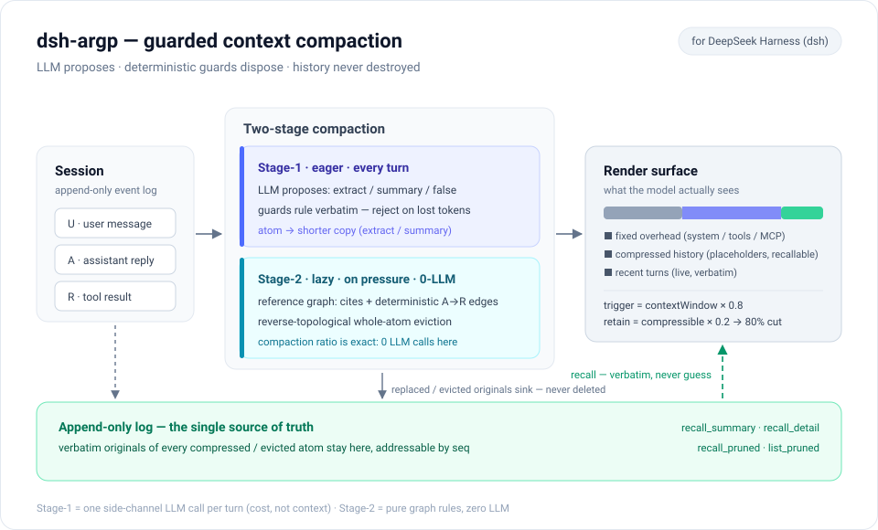

[中文](README.md) | English

# dsh-argp 2.0 — Factor compaction engine: label-addressed eviction + prose condensation + egress gate

[](https://github.com/yoza10635/dsh-argp/actions/workflows/ci.yml)
[](https://github.com/yoza10635/dsh-argp/releases)
[](https://www.npmjs.com/package/dsh-argp)
[](https://www.npmjs.com/package/dsh-argp)
[](LICENSE)

**dsh-argp is a third-party context compaction engine for [DeepSeek Harness](https://github.com/deepseek-ai/deepseek-harness) (dsh)**. 2.0 is the clean form of the factor engine: **tool results are evicted by entity label, deterministically (0 LLM)**, **prose is condensed once per compaction transaction (the only LLM path, double-gated)**, and an **egress gate makes sure a request that would necessarily overflow is never sent**. Everything evicted stays in the append-only log and comes back verbatim via `recall_history(label)`.

> **The 1.x graph engine is retired.** The old scheme (stage-2 reference graph + peratom pipelines + cites edges) is frozen at **npm latest `1.11.2`** (tag `v1.11.2`) and does not continue into 2.x. Graph-era knobs in old profiles are tolerated with a warning under 2.0. The historical CHANGELOG is kept.



```bash
dsh plugin --profile <name> add dsh-argp    # mounted on install; type /argp in a session for live status
```

## Three mechanisms

- **Label-addressed R eviction (the main path, 0 LLM)** — tool results get entity labels (`document:<path>` / `command:<family>` / `errorcode:<CODE>` / `scope:<dir>`); deterministic staleness (superseded reads, newer versions, non-focal turns) scores them; evicted results become a one-line stub (`[已剪·因子 read → document:…（需要原文时 recall_history(…)）]`). **A is never evicted** (prose belongs to the condenser), U is protected by focal/turn guards. The vocabulary note is refreshed only at transaction end (cache-break frequency = compaction frequency).
- **Prose condensation (the only LLM summary path)** — transaction-only, two gates in conjunction: ① prose (system + conversational prose) is ≥50% of the declared window; ② anchored total context ≥ `windowRatio×window`. One-shot native-style summary; barriers and protected spans stay untouched; empty output or failure **keeps the original** (fail-open to safety).
- **§9.37 egress gate** — at pre-step (last request anchored, next request not sent) deterministic capacity math runs: anchored projection (including this step's incoming delta) ≥ declared window − output budget − 2% margin ⇒ **the request is not sent**; a standard compaction transaction runs first. Output budget = max of three sources (`agent.options.maxTokens` / `agent/request` observation / `resolveModelInfo().defaultMaxTokens`), falling back to 0.25×window. The 400 overflow path remains as the last-resort net.

The recall surface is exactly two tools: **`recall_history`** (verbatim log text by labels; intersection-first, cursor/epoch paging, honest epoch-drift warning) and **`list_labels`** (vocabulary drill-down). There is no seq channel — labels are the only address; both share a character budget (5% per call / 10% cumulative, exhaustion stated explicitly).

## Why

Summarizer-style compaction (an LLM rewriting history) pays three prices:

1. **Lossy** — exact tokens (paths, error codes, config values) die first in any rewrite, and are unrecoverable;
2. **Cache wipeout** — rewritten history changes the system+prefix every turn, invalidating cross-turn KV/prefix caches from the change point on;
3. **Uncontrolled ratio** — summary length is at the model's whim; the budget is never honored.

The factor engine's answer: **eviction is deterministic** — same input, same output, 0 LLM, recomputable; **forgetting is reversible** — a stub is one label line, the original comes back byte-for-byte from the append-only log; **the LLM does the one thing it is good at** — prose condensation, only inside a transaction, only when both gates pass.

## Three-scheme measured comparison (T24-J, 2026-11-14/15)

The same 46-turn workload (same prompts, same materials, fully serial single-arm, same
endpoint/model/window 262,144); provider-reported token usage is broken out into its three
components, which one consolidated row folds into a DeepSeek off-peak reference price (in 元):

| Dimension | v1.11.2 | Native (host compaction-basic) | v2.0.0 |
|---|---|---|---|
| Compaction mechanism | LLM summaries + contiguous-prune rewrites + system-head rewrite every turn | est-driven pre-clamp prune + periodic LLM summaries | **Deterministic label group-prune** + prose-condense dual gates + turn-boundary budget trigger |
| Wall clock | 114.7 min | 61.8 min | 43.3 min |
| Input miss tokens (miss) | 9.287M | 1.979M | 1.363M |
| Input hit tokens (hit) | 46.21M | 43.49M | 60.06M |
| Output tokens (output) | 0.343M | 0.378M | 0.283M |
| Prefix cache hit rate | 0.833 | 0.956 | 0.978 |
| **DeepSeek off-peak reference price** | **11.58 元** | **4.36 元** | **3.69 元** |
| Peak KV-resident context (share of declared window) | 78.9% | 50.0% | 98.4% |
| Forgetting reversible | ✗ | ✗ | ✓ `recall_history` byte-for-byte by label |
| Material-needle memory (no-tools turn) | 0/12 | 0/12 | 1/12 |
| Long-term memory (recall-allowed turn) | 7/10 | 2/10 | 3/3 = 100% |
| Hidden artifact suite (T0) | 19/20 | 18/20 | 17/20 |

Note: these are measured results on **local Qwen3.8-Flash-Next** (declared window 262,144) —
same 46-turn workload, same prompts/materials, fully serial single-arm, n=1 per arm; token
counts are provider-reported usage summed over the run (miss = uncached input, hit = cached
input/cached_tokens, output = completion); the reference price folds them at **DeepSeek off-peak
rates per 1M tokens: 1 元 uncached input, 0.02 元 cached input, 4 元 output**. The v2.0.0 column
is the egress-gate-off (`ARGP_FACTOR_EGRESS=0`) paired arm egress0b's settled values (same
profile/env/runtime, full 46 turns; the gate-on default family band 43.8–51.6 min / 5.39–6.62M
is in report §6–9); single-run conclusions passed three checks (per-turn band → same-config
rerun → paired full run), and run1 (+50%) is archived as the outlier-trajectory upper bound, not
tabulated. Peak is the server's cached_tokens (KV-resident prefix) as a share of the declared
window — no arm exceeded the window (v2.0.0 = 258,048 = window − 4,096 block-aligned, reproduced
in both runs; the raw request size peaked at 305K/116%, which is request size only, not context;
admission-count semantics pending endpoint-operator review). Long-term memory (P45) for v2.0.0
is scored on the answered set: 3/3 answered (Q1/Q2/Q9) are verbatim hits and the 7 unanswered
were honestly declined with zero fabrication; 3/10 is recall-budget coverage only (the
auto-grader's truncating extraction mislabeled real hits as MISS; human-graded). 1.x's 7/10 comes
from its seq-addressed recall stack (a real capability, at 2.4× the price and 2.3× the wall
clock); the material-needle turn (T44) is a no-tools, no-recall-channel memory test. All three
T0 failures are **unlocked-shape trajectory judgments** (merge3 return shape unspecified, the
CB-code CLI error-line convention beyond the delivered materials, plugin_error_isolated a
family-wide miss) — not compaction/recall quality regressions. Wall clock includes day-vs-night
server noise (±7%, controlled with compaction-free turns). Full seven-arm data and per-turn detail
live in `CHANGELOG` 2.0.0-alpha.5 and report §12–13; future tags will be **2.0.0**.

**Arm 7 — the egress gate's value, settled (egress0, 2026-11-14)**: same as alpha5 plus
`ARGP_FACTOR_EGRESS=0` (the pre-send gate off; the budget trigger stays and fired 5× — all
0-LLM group prunes) with the length-stop recovery chain as backstop:
**bill 8.59M (miss+0.06×cache+3×output caliber, +50%) / wall clock 60.6 min (+17%, back to
native speed) / cache volume +65% (89.2M vs 54.2M) / raw request-size peak 305K (116% of the
declared window, not context)**; 46/46 zero dead turns, zero wall hits, zero max-tokens.
**Paired rerun settles it (egress0b, same profile/env/runtime, full 46 turns)**: 471 steps /
bill 5.815M / wall 43.3 min — all inside the rc.1 family band, **+1.6% vs alpha5 (noise level;
-5% under DeepSeek off-peak pricing)** ⇒ run1's +50% was an outlier trajectory (a session-wide
"diligent forensics" style draw — T03 case study), not a gate effect. The gate-off structural
signature **reproduced across both runs**: a context ceiling of ~305K (run1 T32 = 305,101 /
egress0b T39 = 305,008, Δ0.03% across trajectories — the trigger line + within-turn protocol
growth as a deterministic combination) vs 191.7K gate-on; harmless on this cache-aware
endpoint (fresh peak 47K far from the fresh wall), fatal-then-rescued on a strict-admission
endpoint (400 → overflow chain, the designed scenario). **Final gate positioning: a pre-send
line of defense for strict-admission endpoints plus ceiling control; NOT a cost optimizer**
(economics are a wash on cache-aware endpoints). `ARGP_FACTOR_EGRESS` default-on stands. 
Runtime note: this endpoint's admission is **prefix-cache-aware** on the runtime path
(cache-assisted 305K admitted, fresh peak only 47K; cache-less probes are rejected on total
count) — the declared window 262,144 is effectively a fresh budget for the runtime path.
The length-stop chain had nothing to rescue here (zero triggers); its backstop value lies
in strict-admission endpoints (the probe-400 world). Data: report §12 and
`wallhit-probe3-admission.json`.

## How it works

### Compaction transaction (prune-tx)

One transaction = `compaction/start` → `compaction/summary` → one `compaction/prune` + matching `replace` per interval → `compaction/end`. The host's `foldSurfaceProjection` requires `shadowedRange` to equal the replace range **exactly** (interval-by-interval). A tool stub clones the original R data and changes only the inner text (keeping callId / role / id), so the issuer A's tool_calls stay paired (no 400). At transaction end the usage anchor resets to a chars estimate; the next successful request re-anchors real usage.

### Triggers (two signals + the egress gate)

1. **Manual `/compact`** — evict everything evictable (hard protections win) + condense prose.
2. **Provider 400 `CONTEXT_WINDOW_EXCEEDED`** — force one prune, then retry (`maxOverflowRetries` defaults to 1, matching stock compaction-basic).
3. **§9.37 egress gate** — intercepts "necessarily overflow" sends before they happen, demoting 400 from a trigger back to a safety net.

> Pre-step **estimate-driven** pressure pruning is retired (`ARGP_FACTOR_PRESSURE=1` exists only as the old-world comparison arm). Destructive rewriting happens only on the deterministic signals above.

### Recall

`recall_history(labels)` returns text from the **log's append origin** (not the stub, not a summary), with `state=shadowed|live` and the hit labels per line; `list_labels(category)` lists vocabulary per facet with coverage counts. Budget exhaustion, no matches, and unknown categories are all stated explicitly — never a silent empty result.

## Model requirements

- **Eviction and the egress gate do not depend on the model**: identical behaviour on any model (0-LLM determinism).
- **Prose condensation** needs an LLM route with purpose=compaction: by default it follows the host route (`agent.options.{provider,model}` + `ctx.llm`); if no route resolves, condensation is disabled, zero network, originals kept. Condensation quality scales with instruction following, but failure always errs toward compressing less.
- Labels come from tool arguments and output (read/edit paths, command family, error codes) — the model is not asked to emit any citation protocol.

## Install & mount

```bash
dsh plugin --profile <name> add dsh-argp
```

**Mounted on install, no manual configuration**: the package's bundle patch (`cordis.patch.yml`) disables the stock summarizer (`- id: compaction-basic / disabled: true`) and `insert`s this plugin; the profile layer should only tune config (modify), never insert again (otherwise `duplicate loader entry id`).

> **⚠️ Installing within 24h of a release? Pin the version.** pnpm 11 defaults `minimumReleaseAge` to **1440 minutes (24h)**: a just-published version is skipped and pnpm **silently falls back to the previous version that passed the cooldown** — no error, just the wrong version. If the error names a version older than npm `latest`, this cooldown is why. Fix: `dsh plugin --profile <name> add dsh-argp@<latest>`, or add `minimumReleaseAgeExclude: [dsh-argp]` to the profile's `pnpm-workspace.yaml`.

> **Inactive under the minimal preset**: ARGP steps back under presets listed in `skipPresets` (default `['minimal']`) — history stays untouched there. To activate under minimal, modify config in the profile with `config: { skipPresets: [] }`.

### Settings knobs (6)

Settings → Plugins → ARGP card (all volatile; changes apply live, no restart):

| Key | Default | Meaning |
|---|---|---|
| `windowRatio` | 0.8 | Trigger line = declared window × this (shared by the egress gate ctx line and condense gate ②) |
| `retainRatio` | 0.2 | Retained target after compaction = trigger line × this |
| `charsPerToken` | 3.5 | Chars→token estimate ratio (real anchored usage takes precedence) |
| `focalTurns` | 1 | Focal turns: tool results in the newest N turns are never evicted |
| `vocabTopN` | 10 | Rows per category in the vocabulary note (the rest via `list_labels`) |
| `recallLimit` | 5 | Default items `recall_history` returns when no limit is given (cap 20) |

### Eval/debug env hatches (snapshotted at construction; re-mount to switch)

| Variable | Effect |
|---|---|
| `ARGP_FACTOR_EGRESS=0` | Disable the egress gate (comparison arm; structural effect = context ceiling 305K vs 192K, economics a wash — default on = the pre-send line of defense for strict-admission endpoints) |
| `ARGP_FACTOR_PRESSURE=1` | Restore legacy pre-step estimate-driven pressure pruning (old-world reproduction) |
| `ARGP_FACTOR_TIER=tiered` | Focal tiering strategy (hard/medium focal bands; default flat) |
| `ARGP_FACTOR_CLIP=1` | C10 clip layer (three-state retention; default off) |
| `ARGP_PERATOM_A2_DEBUG=<dir>` | Dump LLM wire (redacted by default; `_FULL=1` includes text) |

### Status: `/argp`

```text
ARGP 2.0.0-alpha.0 · engine: factor · preset: standard
budget: trigger 209.7k / retain 41.9k · now 88.4k (source=anchored)
prunes: 7 · last 3 ranges / 41 items / 12.8k→3.1k · pruned index 156
recall: 12 calls · 9 hits (75%)
```

`engine` is always `factor`; `ARGP inactive` after `preset` means the session hits `skipPresets`. `source=anchored` means occupancy is anchored to provider-reported real usage (the most accurate). Manual compaction uses the host's stock `/compact`.

## Verification

- **T24-J six-arm comparison (2026-11-14, 46 turns × 6 arms, all serial finishers)**: alpha2/alpha3/alpha4/alpha5 (2.0 factor generations) + native compaction-basic + the 1.11.2 legacy scheme, identical turns2 protocol — the source of the table above; every 2.0 generation finished with zero dead turns and zero 400s; recall face v2 (alpha.4) achieved zero empty label mismatches, the per-turn recall-budget reset was used by the model in production, and long-term memory hit 6/10, the best factor result.
- **Arm 7 egress0 (gate off + length-stop chain backstop, finished the same day)**: bill +50% / wall +17% / cache volume +65%, zero compactions, zero wall hits — **gate-default-on is the only sensible configuration** ("Arm 7" paragraph under the table); the length-stop recovery chain rode along via the bench clone runtime (rc.3 asar surgery + stub dual verification), zero triggers as expected.
- **Regression**: `npm run check` = typecheck + typecheck:spike + smoke + unit tests (275 tests, 273 pass / 0 fail / 2 skipped) + build; egress tests EG-1…14b include the cold-resume backfill lock; recall-face v2 assembly invariants and the per-turn budget reset have mutation locks.
- Historical 1.x graph-engine measurements (four-arm 7/7 probes, 50-turn t-long, etc.) are in the CHANGELOG and git history; they are **not 2.0 numbers** and must not be quoted as such.

## Known limits

- **B-6 window-truncation blind spot**: live nodes that were never replaced get their oldest part dropped by request assembly near the context window, leaving no trace — they are not in the prune vocabulary, so label recall cannot reach them. Mitigation: trigger earlier via ratio budget; the real fix belongs to dsh (B-6 filing).
- **Condensation output tax**: condensation is the only LLM call and is transaction-only; an over-long summary eats the savings. Gate ① (prose ≥50%) and the 20480 output budget bound it, but extremely long prose can still be a net loss.
- **Unlabelled content cannot be evicted**: plain chat or output without paths/commands/error codes is untouched by R eviction and waits for prose condensation. That is the other side of "labels are the only address" (fail-closed: identity is never guessed).
- **Old-log read side**: the old tombstone grammar (v1.3.x–v1.7.x) and old `data.argpCites` are still readable; 2.0 no longer produces them.

## Reproduce

| Experiment | Command | What it verifies |
|---|---|---|
| Full gate | `npm run check` | typecheck / spike types / smoke / 275 tests / build |
| Egress unit tests | `npm run test -- --test-name-pattern=EG-` | three-source budget, cold resume, hatch exclusivity |
| Corpus replay | `node --import ./scripts/ts-import-rewrite-loader.mjs spike/50-t2-replay.ts` | offline replay (skips gracefully when the corpus dir is absent) |

1.x graph/peratom experiment scripts moved to `spike/retired-1x/` (**not compiled**, kept for the record; their findings live in the CHANGELOG and git history).

## Feedback

- **Bugs**: open an [Issue](https://github.com/yoza10635/dsh-argp/issues) with `dsh --version`, the package version, profile config (`windowTokens`/`retainTokens`, …) and a minimal repro.
- **Design / usage questions**: open a [Discussion](https://github.com/yoza10635/dsh-argp/discussions).

## License

MIT
