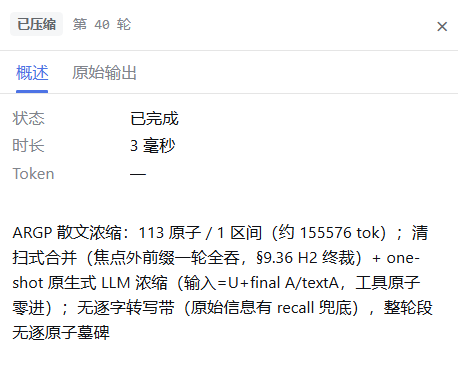

[中文](README.md) | English

# dsh-argp — entity-label context compaction: deterministic label pruning of tool results (0 LLM) + LLM prose summaries at compaction time

[](https://github.com/yoza10635/dsh-argp/actions/workflows/ci.yml)
[](https://github.com/yoza10635/dsh-argp/releases)
[](https://www.npmjs.com/package/dsh-argp)
[](https://www.npmjs.com/package/dsh-argp)
[](LICENSE)

**Long sessions fill the window, and per-turn LLM summaries are expensive while shredding the prefix cache.** This plugin is a context compaction plugin for [DeepSeek Harness](https://github.com/deepseek-ai/deepseek-harness) (dsh): only stale, superseded, out-of-focus tool results are pruned deterministically by entity label (0 LLM); pruned originals stay in the append-only log and come back verbatim by label or keyword; conversation prose is summarized by LLM only inside compaction transactions.

Same 46-turn workload, measured (n=1, **2026-11-14/15, 2.0-series wall-trigger shape**; caliber in the appendix below): **¥11.58 → ¥3.69** · **114.7 min → 43.3 min** · **97.8% prefix cache hit rate**. The 2.2.0 default shape moves the trigger earlier via the egress gate; the full re-measure of the same workload comes to ¥4.18 / 96.5% / 73.0% utilization — the two trigger strategies are different calibers, booked separately in the appendix, never substituting for each other. Full replay on 2026-11-23: the host's native compaction **never fired once** — 4 ARGP compaction transactions, ≈0.66M tokens shadowed in total; desktop screenshot below.



- **0-LLM eviction**: judgment rests only on facts that already happened (a newer read of the same file, the file was modified, a current-turn label reference); same input, same output, recomputable, and the model is never asked to cooperate.
- **Forgetting is reversible**: stubs carry label addresses and the originals always stay in the log — `recall_history` fetches verbatim by label, `search_history` finds and fetches verbatim by literal keyword (including conversation prose already condensed away).
- **The prefix cache survives**: history is rewritten only inside compaction transactions and the system head is not rewritten every turn; the 97.8% hit rate comes from here.
- **The LLM is always on standby but never steals work**: tool pressure flows entirely through the 0-LLM prune channel; prose summarization is issued only inside compaction transactions and only with dispatch decision-table approval (prose ≥50% of the declared window remains one of the criteria; the legacy two-gate shape is kept only in the compressor's off/shadow worlds), roughly 120 turns of buildup under ordinary load — short and ordinary tool sessions run at zero LLM cost.

## Install

```bash
dsh plugin --profile <name> add dsh-argp
```

Works out of the box: the package ships its own bundle patch (disables the stock `compaction-basic` and mounts this plugin); the profile layer only carries config overrides. Host admission range and the minimal-preset caveat live in the appendix below.

## Usage

- Type **`/argp`** in a session: budget, trigger line, prune and recall stats. **`/compact`**: run one manual compaction (full prune + prose condensation).
- Automatic compaction (default): under compaction takeover the **egress gate is on by default** (since 2.2.0) — before a request is sent, anything at or above the "window − output budget − 2%" line triggers a standard compaction transaction (full prune + approved prose condensation) first; provider overflow rejection (400) is demoted to the last-resort net. To compact earlier, set the single "Compaction threshold" (Settings → Plugins) to a 0–1 ratio (live, no restart; `ARGP_FACTOR_EGRESS=0` is a hard override that closes even the ratio line).
- Three recall tools are automatically available to the model: `recall_history` / `search_history` / `list_labels` (shared character budget: 5% per call / 10% cumulative of the window; exhaustion is stated explicitly).

```text
ARGP 2.0.0 · engine: factor · preset: standard
budget: trigger 209.7k / retain 41.9k · now 88.4k (source=anchored)
prunes: 7 · last 3 ranges / 41 items / 12.8k→3.1k · pruned index 156
recall: 12 calls · 9 hits (75%)
```

`source=anchored` means usage is anchored to provider-reported truth; `ARGP inactive` means the session hit `skipPresets`.

## How it works

**Governing principle: tool results may be pruned; conversation prose is only touched inside compaction transactions.**

- **Eviction (0 LLM)**: tool results get entity labels (`document:<path>` / `command:<family>` / `errorcode:<CODE>` / `scope:<dir>`, plus a `tool:<registered-name>` fallback address); judged evictable, a result becomes a one-line labeled stub; undecided candidates queue by recency and size. Prose is never evicted; focal atoms are protected.
- **Prose condensation**: the plugin's only LLM path, transaction-only — under takeover it is issued with dispatch decision-table approval (the summary reuses the host's own context assembly, hitting the prefix cache, and lands in the sink bill); "prose ≥ 50% of the declared window" remains one of the criteria, and the legacy two-gate conjunction is kept in the compressor's off/shadow worlds. Empty output or failure keeps the original. Either way this path stays a dedicated exit for paste-heavy sessions: ordinary turns add only a few hundred prose tokens each, so at a 262K window the line needs ≈120 turns (≈200 in pure chat; heavier pasting triggers earlier — exactly what this channel is designed for). Replay evidence: all 4 compactions were bounded ARGP transactions; the host's native compaction never woke.
- **Overflow fallback (last line of defense)**: when a request is rejected by the provider for overflow (400), a standard compaction transaction (full prune + prose condensation) runs automatically and the request is retried. With the egress gate on by default this is the fallback for cases where the gate yields (unknown declared window, lost anchor, empty prune) — the net is never removed.
- **Recall**: stubs carry labels; originals come back verbatim by label; content with no label — especially condensed-away conversation prose — is found and fetched verbatim by literal keyword (2.1.0: tiered previews, `hit=` second-hop full fetch, a label distribution when there are too many hits). After compaction, the vocabulary note tells the model to recall by label or keyword.

Strategy values are fixed (trigger line = the earliest of 0.8× the declared window and the egress line "window − output budget − 2%", the egress gate being on by default under takeover; retention target 0.2, 1 focal turn, 5 default recall items), and the single setting "Compaction threshold" is unset by default — when set, it replaces the egress line with that ratio — details in the appendix. Transaction protocol, host-compat surface and invariants live in [ARCHITECTURE.md](ARCHITECTURE.md); the structural edge over summary-based compaction: recomputable, reversible, cache-friendly.

## Measured comparison (2026-11-14/15, same 46-turn workload, local Qwen3.8-Flash-Next)

Same prompts, same materials, fully serial single-arm, same endpoint/model/window 262,144; provider-reported token usage broken out in full, with one row folded into a DeepSeek off-peak reference price (caliber notes in the appendix):

| Dimension | v1.11.2 | Native (host compaction-basic) | v2.0.0 |
|---|---|---|---|
| Compaction mechanism | LLM summaries + contiguous-prune rewrites + system-head rewrite every turn | est-driven pre-clamp prune + periodic LLM summaries | **Deterministic label group-prune** + prose-condense dual gates + turn-boundary budget trigger |
| Wall clock | 114.7 min | 61.8 min | 43.3 min |
| Input miss tokens (miss) | 9.287M | 1.979M | 1.363M |
| Input hit tokens (hit) | 46.21M | 43.49M | 60.06M |
| Output tokens (output) | 0.343M | 0.378M | 0.283M |
| Prefix cache hit rate | 83.3% | 95.6% | 97.8% |
| **DeepSeek off-peak reference price** | **¥11.58** | **¥4.36** | **¥3.69** |
| Declared-window context utilization | 78.9% | 50.0% | 98.4%† |
| Forgetting reversible | ✓ `recall`/`recall_detail` | ✗ | ✓ `recall_history` by label + `search_history` by content (prose too) |
| Long-term memory (recall-allowed turn) | 7/10 | 2/10 | 8/10 (supplementary recall turns) |
| Hidden artifact suite (T0) | 19/20 | 18/20 | 20/20 |

† All three columns measured 2026-11-14/15 (host line unchanged since, comparable); the 2.0-series column is the **wall-trigger** caliber — transactions fire on the provider's 400 overflow rejection as the fallback, compressing only at 98.4% of the window. The 2.2.0 default shape moves the trigger earlier via the egress gate; the full re-measure of the same workload comes to ¥4.18 / 40.8 min / 96.5% / 73.0% (2026-11-26, 46/46, 0 dead turns; one client-side stream stall at T37 re-sent and passed, counted as INFRA) — different trigger strategies, different calibers: the two books are booked separately, never mixed into one column; full ledger in the appendix. Long-term memory 8/10 and T0 20/20 are 2.0.0-era measurements; 2.2.0 re-runs are scheduled.

## Model requirements

- **Eviction does not depend on the model**: identical behavior on any model (0 LLM determinism).
- **Prose condensation** needs an LLM route for the compaction purpose; by default it follows the host's `agent.options`. If the route is unavailable, condensation is disabled, zero network, originals kept. Condensation quality scales with instruction-following, but the failure direction is always "condense less".
- Labels come from tool arguments and outputs; the model is not required to emit any citation protocol.

## Known limitations

- **Window approach and blind-spot diagnostics**: un-prunable live nodes (no label, outside the prune vocabulary) form a diagnostic blind spot as occupancy approaches the declared window; the `/argp` status card surfaces an explicit risk line once un-prunable live reaches 80% of the window (approximate diagnostic). Measured (2026-11-19, 40K-window probe): the current host does **not** silently truncate oversized requests — it sends them in full and returns an explicit `CONTEXT_WINDOW_EXCEEDED`, and session archives stay complete; evicted content is therefore never lost and can be fetched verbatim via `search_history(keyword=...)` (2.1.0). Mitigation: the pre-send egress check (compact first, then send) is on by default under compaction takeover (since 2.2.0); the trigger point can be moved earlier via the "Compaction threshold" ratio setting.
- **The egress gate is on by default under compaction takeover** (since 2.2.0): the pre-step prunes first once a request projects at or above the "window − output budget − 2%" line, preventing two things — ① on endpoints whose real wall far exceeds the declared window (gateway auto-escalation, multi-tier models) 400 never fires while the host clamps `max_tokens` to "window − prompt": sessions with a large fixed face (huge AGENTS.md, many tool schemas) fall into the "clamp line < pressure line (0.8×window)" dead zone and turns get clamped into starvation (observed both on the bench and on a real DeepSeek endpoint with the gate off; both ran cleanly with it on); ② the 400→retry→full-replay waste of requests doomed to overflow. The control/eval arm `ARGP_FACTOR_EGRESS=0` is a hard override (closes even the ratio line; behavior falls back to the 400-fallback net, whose precondition is real wall ≈ declared window); setting "Compaction threshold" > 0 installs a custom ratio line. The compressor's legacy worlds (`ARGP_FACTOR_DISPATCH=0/1`) stay off by default — production behavior unchanged.
- **Condensation output tax**: condensation is the only LLM call, and only inside a transaction; an over-long summary can eat the savings. The prose ≥50% criterion and the summary output cap bound it, but extremely prose-heavy sessions may still not pay off. Under takeover the summary reuses the host's hot prefix (measured 93–98% hit), so most of the input tax rides the cache price.
- **Post-prune address coverage**: every tool result carries at least one `tool:<registered-name>` address (orphan results with a missing tool name excluded); post-prune vocabulary and interaction rows always list addresses and previews — the old "no entity label, no recall" caveat was retired with the tool factor key. Pure chat prose never enters tool pruning and gets no guessed identity (fail-closed), so it has **no label address** — but since 2.1.0 it is recoverable verbatim by literal keyword through `search_history` (including text already condensed away). Labels are addresses; keyword is the content channel.
- **Oversized results vs. global pre-prune**: under ARGP takeover the host's autonomously triggered global pre-prune is stripped from the presets by this package; the live pre-prune is the *same host service borrowed by this package inside each compaction transaction* (threshold ≈8192 chars, tool-name agnostic), and the host only permits rewriting `tool/result` nodes **of the current (open) turn** — what gets cut into head/middle/tail are over-limit `recall_history`/`list_labels` results **freshly returned in that turn**: head and tail visible, middle invisible within the turn (the original always stays in the append-only log and the ledger can re-fetch the full text). Over-limit results from older turns bypass the pre-prune (the host rejects rewrites outside the open turn) and are covered by group-prune, which evicts their whole group as it ages out. For precise long content, prefer small item drill-downs or recall across turns rather than relying on the middle of one giant in-turn full view.
- **Legacy log read path**: old tombstone grammar (v1.3.x–v1.7.x) and old `data.argpCites` remain readable, but 2.0 no longer emits them.

## Appendix: install and host compatibility

- **Host requirement**: DeepSeek Harness `>=0.2.0-rc.1 <0.3.0-0` (prereleases participate in matching). Both npm `latest` and `next` are on `0.2.2-rc.5` now (0.2.x line; either channel installs directly, matching desktop builds included; install smoke tested on rc.3). Hosts still on the old `0.1.x` line are outside the admission range and the plugin is **silently skipped**. If you don't see `[argp]` logs / the `/argp` command after install, clone this repo and run the preflight: `node scripts/doctor.mjs --dsh <dsh install root>`.
- **Inactive under the minimal preset** (`skipPresets: ['minimal']`). To enable it there, add `config: { skipPresets: [] }` via a profile-level modify.
- **Preset override block (whole-replacement snapshot)**: the GENERATED block at the end of this package's `cordis.patch.yml` modifies the three default presets `standard / cordis / ptc` by replacing their config wholesale — stripping the `compaction-basic` / `tool-result-pruner` rows and the `isolate` block inside their compaction group (the host patch layer has no partial-surgery semantics for presets; whole replacement is the only mechanism that disables native compaction under the default presets). The profile layer's own patch is applied *after every bundle layer*: **your customizations win over this package**, not the other way round; custom preset ids beyond these three are untouched. If your own preset's compaction group was copied from a host template, apply the same surgery there — drop the two stock rows *and* the whole `isolate:` block, all three (dropping the providers but keeping `isolate` leaves `/compact` waiting forever; keeping the stock rows silently reverts prose compaction to native). When the host updates its shipped presets, regenerate the snapshot with `scripts/generate-preset-overrides.ts`; until then the snapshot masks those changes.

## Appendix: tuning and measurement caliber

- **Fixed strategy values**: trigger line = the earliest of 0.8× the declared window and the egress line (window − output budget − 2%; on by default under takeover), retention target 0.2, estimation weighted by character class (non-CJK 3.5, CJK 1.7 chars/token, κ calibrated on the Qwen3.8 tokenizer — estimation is only a fallback; occupancy anchors on provider usage), 1 focal turn, 10 vocabulary rows per category, 5 default recall items.
- **The single setting, "Compaction threshold"** (Settings → Plugins, unset by default): set a 0–1 ratio and the egress line becomes declaredWindow × ratio — context reaching that line is **compacted before sending** (live, no restart; prose condensation still rides dispatch approval, "prose ≥ 50% of the declared window" being one of the criteria). **When unset, the egress gate still runs on the legacy formula line under takeover** (since 2.2.0, sealing the "host clamp line < pressure line" starvation band); in the compressor's legacy worlds (`ARGP_FACTOR_DISPATCH=0/1`) it stays off by default — there, compaction transactions are triggered by the provider's overflow rejection (400) or by manual `/compact` (precondition: real wall ≈ declared window). The five other old knobs stay retired (same-named keys in old profiles are tolerated with a warning).
- **Base**: local Qwen3.8-Flash-Next (declared window 262,144), same 46-turn workload, fully serial single-arm, n=1 per arm.
- **Token and price caliber**: token counts are provider-reported usage summed over the run (miss = uncached input, hit = cached input, output = completion); the reference price folds them at **DeepSeek off-peak rates of 1 / 0.02 / 4 元 per 1M tokens**.
- **v2.0.0 column**: the 46-turn run with the pre-send overflow check off (the default shape during 2.0.1–2.1.0; since 2.2.0 the egress gate is on by default under takeover; eval-tier details in [ARCHITECTURE.md](ARCHITECTURE.md) §11); declared-window context utilization is the server's cached_tokens (KV-resident prefix), while 305K is request size, not context.
- **2.2.0 default-shape re-measure (early-trigger caliber, not interchangeable with the column above)**: 2026-11-26, 2.2.0 build; 46/46 completed, 0 dead turns (one T37 client-side stall, re-sent, INFRA): **¥4.18 / 40.8 min / 96.5% hit / 73.0% peak utilization** — at this config's mct=65536 the egress line sits at window − output budget − 2% ≈ 73%×window; at typical desktop output budgets the line returns near 0.8×window and the gap vs the old book narrows. The delta is entirely the price of the trigger point: the egress gate moves compaction from "after the wall" to "before the request", trading window headroom to seal the "host max_tokens clamp < pressure line" starvation band; `ARGP_FACTOR_EGRESS=0` restores the wall-trigger fallback shape. 6 of the 9 transactions were §G cache-shaped summaries with a 0.3–4% miss share of their own. Long-term memory and T0 re-runs on 2.2.0 are scheduled.
- **Long-term memory**: v2.0.0 answered 3/3 on the first turn (coverage 3/10), and 3 supplementary recall turns (budget reset each turn) recovered 5 more → **8/10**; the remaining 2 are unreachable: one page was touched only by a directory-level grep (scope directory address only; the recall guidance teaches document/command/errorcode), and one page was never read — its content never entered the session log. The model answered C honestly. 1.x's 7/10 comes from its seq-addressed recall stack (`recall`/`recall_detail`) — a real capability, at 2.4× the price and 2.3× the wall clock.
- **T0**: hidden artifact suite 20/20; comparison summary in `CHANGELOG` 2.0.0.

## Upgrading from 1.x

The 1.x graph engine is retired: the old scheme is frozen at npm **`1.11.2`** (tag `v1.11.2`). 2.x maintains only the factor engine; graph-era knobs in old profiles are tolerated with a warning, and the historical CHANGELOG is kept.

## Development

One-shot quality gate: `npm run check` (typecheck + smoke + unit tests + build + artifact consistency). Gate matrix and targeted regressions: [CONTRIBUTING.md](CONTRIBUTING.md); transaction protocol and design baseline: [ARCHITECTURE.md](ARCHITECTURE.md).

## Feedback

- **Bug**: open an [Issue](https://github.com/yoza10635/dsh-argp/issues) with `dsh --version`, the package version, profile config and a minimal reproduction.
- **Design discussion / usage questions**: open a [Discussion](https://github.com/yoza10635/dsh-argp/discussions).

## License

MIT
