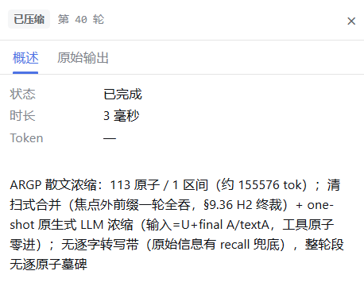

[English](README.en.md) | 中文

# dsh-argp — 长会话上下文压缩，比 LLM 摘要更便宜，而且遗忘可撤销

[](https://github.com/yoza10635/dsh-argp/actions/workflows/ci.yml)
[](https://github.com/yoza10635/dsh-argp/releases)
[](https://www.npmjs.com/package/dsh-argp)
[](https://www.npmjs.com/package/dsh-argp)
[](LICENSE)

**长会话吃满上下文窗口，逐轮 LLM 摘要又贵、又慢、又打碎前缀缓存——而且忘掉的找不回来。** 本插件是 [DeepSeek Harness](https://github.com/deepseek-ai/deepseek-harness)（dsh）的上下文压缩插件，换了个压缩方向：只把「过时、被取代、非焦点轮」的工具结果按实体标签**确定性剪掉（0 LLM，同输入同输出、可复算）**，原文恒在 append-only 日志、按标签或关键词逐字取回；对话正文只在压缩事务内做 LLM 摘要，轮间不动前缀。

**对比逐轮 LLM 摘要式压缩：成本 −68%（11.58 → 3.69 元）· 墙钟 −62%（114.7 → 43.3 min）· 前缀缓存命中 97.8%**¹

**对比宿主原生压缩：价格相近（缺省形态 4.18 元 vs 原生 4.36 元²），但遗忘可撤销——长程记忆 8/10 对原生 2/10³，全程确定性可复算，工具型重会话压缩事务 0 LLM**

```bash
dsh plugin --profile <name> add dsh-argp
```

装完即用：包自带 bundle patch（关掉宿主 `compaction-basic` 并挂载本插件），profile 层只做配置覆盖。宿主准入区间与 minimal preset 的注意点在文末附录。

> ¹ 同一 46 轮工作量、全串行单臂、每臂 n=1（2026-11-14/15，本地端点、声明窗 262,144）。这组数字是**撞墙触发**形态（2.0 线）：压缩由 provider 超窗拒收兜底触发、贴墙 98.4% 才压。2.2.0 起缺省为**前移触发**形态（发请求前先压），同工作量全量复测为 **4.18 元 / 40.8 min / 96.5% 命中 / 73.0% 利用率**（2026-11-26，46/46 完赛 0 死轮）——触发策略不同、口径不同，两本账并列互不顶替，全额账目见附录。
>
> ² 原生 = 宿主 `compaction-basic` 同工作量实测。这对价差有配置敏感性：输出预算较小的桌面配置下线回到 0.8×窗附近，差价收窄（见附录 2.2.0 复测条）。
>
> ³ 允许召回轮口径；8/10 为 2.0.0 实测，2.2.1 补充召回轮复测在「逐字找回材料原文」轴上有结构性出带（诚实轴如实拒答），两笔账见附录长程记忆条，一起读。



2026-11-23 全卷重放：宿主原生压缩**全程零唤醒**，4 笔 ARGP 压缩事务合计遮蔽约 66 万 tok——上图即该轮实拍。

## 适合谁 / 不适合谁

**适合，如果你——**

- 跑**工具密集长会话**（大量读文件、跑命令、搜索）：剪枝只依据已发生的事实判定（同文件更新读取、文件被改、当轮引用），不要求模型配合，同输入同输出、可复算；
- 希望**遗忘可撤销**：被剪原文逐字留在日志，`recall_history` 按标签取回、`search_history` 按字面关键词取回（含已被浓缩请离场的对话正文）；
- 需要**账目可控**：除正文浓缩外全程 0 LLM——常规负载约 120 轮才够浓缩判据线，工具会话与短会话全程零 LLM 开销。

**不适合，如果你——**

- 期待「压缩零代价」：每笔压缩事务必然引起一次保留段重灌（压缩后首个请求近零命中、次发恢复）——这笔一次性缓存税是设计代价，不是缺陷（详见已知限制）；
- 宿主还在 `0.1.x` 线（不在准入区间，插件会被静默跳过），或跑 minimal preset（缺省不生效，需 profile 加一行配置）；
- 窗口 <64K 或重附件会话：barrier/附件面没有任何可释放机制，需按实测附件量在建议窗上另加计（见已知限制建议窗条）。

## 30 秒上手

- 会话里输入 **`/argp`**：预算、触发线、剪枝/召回/缓存审计一张卡。**`/compact`**：手动压缩一次（全量剪 + 正文浓缩）。
- 自动压缩缺省已开：发请求前按「声明窗 − 输出预算 − 2%」线先执行标准压缩事务再发送（2.2.0 起缺省开）；provider 超窗拒收（400）退为最后兜底。唯一旋钮是设置项「压缩阈值」（Settings → Plugins，设 0–1 比例即把触发线前移、即时生效）；`ARGP_FACTOR_EGRESS=0` 硬关回撞墙兜底形态。
- 召回三工具 `recall_history` / `search_history` / `list_labels` 对模型自动可用（共享单次 5%、累计 10% 窗的字符预算，耗尽会显式说明）。

```text
ARGP 2.3.0 · engine: factor · preset: standard
world: dispatch=takeover@live egress=on(old-line)@live tiered=flat@boot clip=off@boot qscore=off@boot pressure=off@boot shadow=off@boot peratomDebug=off@live
budget: trigger 209.7k / retain 41.9k · now 88.4k (source=anchored)
prunes: 7 · last 3 ranges / 41 items / 12.8k→3.1k · pruned index 156
recall: 12 calls · 9 hits (75%) [this process]
cache (provider usage; per-request prefix reuse):
  · turn 40 step 1 · prompt 88.4k / cached 2.3k (3%) · refill [tx 7c42e91b]
  · turn 41 step 1 · prompt 90.6k / cached 85.7k (95%)
post-compaction: 1 refill(s) · 0 repeat miss(es) [this process]
```

`source=anchored` 表示占用锚定在 provider 回报的真实 usage，`cache` 段读同一份 usage——压缩后首请求 `refill` 是必然代价，同一事务的续作仍 `repeat-miss` 才说明另有抖前缀源。`world` 行是当前实际生效的世界指纹（env 派生值 + 生效时机，排障先看它）。`ARGP inactive` 表示命中 `skipPresets`。

## 实测对照（同一 46 轮工作量，2026-11-14/15，本地 Qwen3.8-Flash-Next，声明窗 262,144）

| | 逐轮 LLM 摘要（v1.11.2） | 宿主原生 | 本插件 2.0 线¹ | 本插件缺省形态¹（2.2.0 起） |
|---|---|---|---|---|
| 参考定价（DeepSeek 闲时） | 11.58 元 | 4.36 元 | **3.69 元** | 4.18 元 |
| 墙钟 | 114.7 min | 61.8 min | **43.3 min** | 40.8 min |
| 前缀缓存命中率 | 83.3% | 95.6% | **97.8%** | 96.5% |
| 长程记忆（允许召回轮） | 7/10 | 2/10 | **8/10** | 2.2.1 复测见附录 |
| 遗忘可撤销 | ✓ | ✗ | ✓ | ✓ |

¹ 每列 n=1；2.0 线列为撞墙触发、末列为前移触发——触发策略不同即口径不同，两本账并列互不顶替。token 全分解、利用率、隐藏工件套件（T0）与 2.2.1 第三笔账在附录《实测对照与口径》及调参附录的复测条目里，本表是它们的摘要。

## 它怎么工作

**总原则：工具结果可剪，对话正文只在压缩事务内动。**

- **剪枝（0 LLM）**：工具结果按实体身份贴标签（`document:<path>` / `command:<family>` / `errorcode:<CODE>` / `scope:<dir>`，另有 `tool:<注册名>` 兜底地址）；判定成立的换成一行标签桩，判不上的按新旧与体积排队。正文永远不剪，焦点受保护。
- **正文浓缩（唯一 LLM 通路）**：只在压缩事务内、满足发放判据才触发（「正文 ≥ 50% 声明窗」是判据之一；常规负载约 120 轮才够线）。摘要请求与主对话逐字节共享前缀（实测 98.8% 命中）；空输出或异常保原文——失败方向永远是「少压」。
- **超窗兜底（最后防线）**：请求被 provider 以超窗拒收（400）时，自动执行一次标准压缩事务再重试，网不拆。
- **召回**：桩里带标签，原文按标签逐字取回；无标签的已离场内容按字面 keyword 经 `search_history` 从日志逐字取回。事务收尾注入本会话词表快照，模型每轮可见。

固化策略值（触发线、保留目标、估算口径）见附录《调参与实测口径》；事务协议、宿主兼容面与不变量证明见 [ARCHITECTURE.md](ARCHITECTURE.md)。

## 模型要求

- **剪枝不依赖模型**：任何模型上行为一致（0 LLM 确定性）。
- **正文浓缩**需要一条 compaction 用途的 LLM 路由，缺省自动跟随宿主 `agent.options`；路由不可用时浓缩自动关闭、零网络、保原文。浓缩质量随模型指令遵循能力缩放，失败方向永远是「少压」。
- 标签来自工具参数与输出，不要求模型配合输出任何引用协议。

## 已知限制

三条最影响选型的：

- **压缩后首个请求必然重灌一次（不可避免的缓存税）**：压缩改写早期上下文，保留段在本次请求里无法复用前缀——实测一发 239.5K prompt 只命中约 0.2K（首字 47s ≈ 全量 prefill），次发即回到 94%+。`/argp` 的 `cache` 段直接读 provider usage 区分「压缩后首请求 refill」与「同事务续作 repeat-miss」：前者是设计代价，后者才说明另有抖前缀源（目录/系统段）。治理方向是减少事务次数而不是提高单次压缩率。
- **建议窗口（W_min 口径，2.2.1 起）**：健康会话所需窗口的下限 ≈ 实测固定面（system/工具 schema/常驻文件）+ 焦点名额预算 + 新鲜散文（常规 ~5K token）+ 检查点/桩面（~3K）+ 输出预算（mct）+ 余量。其中 **barrier/附件面是唯一无机制可释放项**（image/file 不可文本召回，组剪与摘要都不碰），不计入上述——**建议窗 ≥64K**（不含附件面与超大粘贴；重附件会话按实测附件量加计）。状态卡的硬面 F 为近似口径（focal/sticky/召回对等硬位未计），展示与推导一律按「近似」理解。
- **窗口逼近与盲区诊断**：不可剪的 live 节点（无标签、不在剪枝词表）在占用逼近声明窗时构成诊断盲区，`/argp` 状态卡在不可剪 live 达声明窗 80% 时显式露出风险行（近似诊断）。实测（2026-11-19，声明窗 40K 探针）：当前宿主对超窗请求**不做无痕截断**——全量发出并返回显式 `CONTEXT_WINDOW_EXCEEDED`，会话档案恒完整；因此离场内容不丢，可经 `search_history(keyword=...)` 按内容逐字取回（2.1.0）。缓解：超窗预检（先压后发）在压缩接管下已缺省开启，触发点可用设置「压缩阈值」（比例线）前移。

<details>
<summary>其余五条已知限制（全文，点开看）</summary>

- **出口闸在压缩接管下缺省开启**（2.1.1 起）：pre-step 按「窗 − 输出预算 − 2%」线先剪后发，防两件事——① 真实墙≫声明窗的端点（网关自动升档、模型多档位）400 永不触发，而宿主会把 max_tokens 钳到「窗 − prompt」：大固定面（超大 AGENTS.md、大量工具 schema）会话落入「钳制线 < pressure 线(0.8×窗)」的死亡带时，轮次被钳成空转（台架与真实 DeepSeek 端点均实测过门关形态的「生成预算钳至最小、轮次空转」，门开全程正常）；② 注定超窗请求的 400→重试→全量重灌浪费。对照/评测臂 `ARGP_FACTOR_EGRESS=0` 硬关（优先于设置项——比例线也关；关后回退「400 兜底网」形态，其适用前提=真实墙≈声明窗）；设置「压缩阈值」>0 自定义比例线。压缩器旧世界（`ARGP_FACTOR_DISPATCH=0/1`）缺省仍关，现网行为不变。
- **摘要调用也算账、也吃缓存**：手动 `/compact` 与自动压缩现在共用同一套**宿主同款上下文装配**（system 头 + 路由历史 + 尾部指令），与主对话逐字节共享前缀——实测手动压缩的摘要请求 116,736/118,135 命中（98.8%，14.0s），此前走旧 A 形态（重建 `U:/A:` transcript）是 0 命中 / 33.3s。摘要输出仍受「正文 ≥ 50%」判据与输出预算共同限幅，极端长文仍可能不划算。
- **剪后地址覆盖面**：每枚工具结果至少带一枚 `tool:<注册名>` 地址（工具名缺失的孤儿结果除外），剪后词表/交互段必列地址与预览——「没有实体标签就找不回」的旧口径已随 tool 因子键退役。纯聊天正文不进工具剪枝、不猜身份所以**没有标签地址**（fail-closed），但 2.1.0 起可按字面 keyword 经 `search_history` 从日志逐字取回（含已被浓缩请离场的原文）——标签是地址、keyword 是内容通道。
- **超大结果与全局预剪的交互**：压缩接管下，宿主自主触发的全局预剪已被本包 preset 摘除；实际生效的预剪是本包**随压缩事务**借用的同一服务（阈值 ≈8192 chars，不认工具名），且宿主只允许改写**当轮（open turn）**的 tool/result——被切的是超限的**当轮刚返回**的 `recall_history`/`list_labels` 结果：头/中/尾三段，头尾可见、中段轮内不可见（原文恒在 append-only 日志，账本可再取全文）。老轮超限结果不经预剪（宿主拒绝 open-turn 外改写），由组剪兜底整组赶旧。需要精确长内容的召回，优先 item 钻取小片段或分轮召回，勿依赖单轮超大 full 视图的中段完整。
- **旧日志读侧**：老墓碑文法（v1.3.x–v1.7.x）与老 `data.argpCites` 仍可读，但 2.0 不再生成它们。

</details>

## 附录：安装与宿主兼容

- **宿主要求**：DeepSeek Harness `>=0.2.0-rc.1 <0.3.0-0`（预发布参与匹配）。npm `latest` 与 `next` 现均为 `0.2.2-rc.5`（0.2.x 线，任一渠道可直接安装，对应桌面版同线；安装冒烟实测于 rc.3）。宿主仍停在 `0.1.x` 老线时不在准入区间，插件会被**静默跳过**。装完不见 `[argp]` 日志 / `/argp` 命令时，克隆本仓库跑预检：`node scripts/doctor.mjs --dsh <dsh 安装根>`。
- **极简（minimal）preset 下默认不生效**（`skipPresets: ['minimal']`）。需要时在 profile 层 modify 加 `config: { skipPresets: [] }`。
- **preset 覆盖块（整段替换快照）**：包尾 GENERATED 段对 `standard / cordis / ptc` 三枚默认 preset 做整段 modify——摘除其组内 `compaction-basic` / `tool-result-pruner` 行与 `isolate` 块（宿主 patch 层对 preset 没有局部手术语义，整段替换是缺省 preset 下关掉原生压缩的唯一机制）。层次序：profile 层的 patch 在所有 bundle 层之后应用——**你的自定义赢过本包**，不是反过来；这三枚之外的自定义 preset id 本包完全不碰。若你自己的 preset 的 compaction 组是从宿主模板复制的，需做同款手术（摘上述两行 + 整个 `isolate:` 块，三者缺一不可：摘 provider 留 isolate 会让 `/compact` 永久等待；留 stock 行则正文压缩静默回退原生）。宿主更新 shipped preset 后需重跑 `scripts/generate-preset-overrides.ts` 重生成快照对齐，期间快照会遮蔽宿主改动。

## 附录：实测对照与口径

同提示词、同材料、全串行单臂、同端点/模型/窗 262,144；token 按 provider 回报 usage 全分解列示，最后一行按 DeepSeek 闲时价折算：

| 维度 | v1.11.2 | 原生（宿主 compaction-basic） | v2.0.0 |
|---|---|---|---|
| 压缩机制 | LLM 摘要 + 连续剪重写 + 系统头逐轮重写 | est 估算预钳 prune + 定期 LLM 摘要 | **确定性标签组剪** + 正文浓缩双闸 + 轮界预算触发器 |
| 墙钟 | 114.7 min | 61.8 min | 43.3 min |
| 输入未命中 tokens（miss） | 9.287M | 1.979M | 1.363M |
| 输入命中 tokens（hit） | 46.21M | 43.49M | 60.06M |
| 输出 tokens（output） | 0.343M | 0.378M | 0.283M |
| 前缀缓存命中率 | 83.3% | 95.6% | 97.8% |
| **DeepSeek 闲时参考定价** | **11.58 元** | **4.36 元** | **3.69 元** |
| 声明窗上下文利用率 | 78.9% | 50.0% | 98.4%† |
| 遗忘可撤销 | ✓ `recall`/`recall_detail` | ✗ | ✓ `recall_history` 按标签逐字取回 |
| 长程记忆（允许召回轮） | 7/10 | 2/10 | 8/10（补充召回轮） |
| 隐藏工件套件（T0） | 19/20 | 18/20 | 20/20 |

† 三列均为 2026-11-14/15 实测（宿主线未变，可比），2.0 线列为**撞墙触发**口径：压缩事务由 provider 超窗拒收（400）兜底触发，贴墙 98.4% 才压。2.2.0 起缺省形态出口闸缺省开、触发前移，同工作量全量复测为 4.18 元/40.8 min/96.5%/73.0%（2026-11-26，46/46 完赛 0 死轮；T37 客户端断流一次重发即过，INFRA 不计死轮）——触发策略不同、口径不同，两本账不同列混排，全额账目与换算见下条。长程记忆 8/10 与 T0 20/20 为 2.0.0 口径；2.2.1 已复测（T0 19/20=历史同条单红、补充召回轮首基线，口径见下条）。

## 附录：调参与实测口径

- **数据基座**：本地 Qwen3.8-Flash-Next（声明窗 262,144）、同一 46 轮工作量、全串行单臂、每臂 n=1。
- **token 与价格口径**：token 按 provider 回报 usage 全程求和（miss=输入未命中，hit=输入命中，output=输出）；参考价按 **DeepSeek 闲时 1 / 0.02 / 4 元每百万 tokens** 折算。
- **v2.0.0 列**：超窗预检关闭形态的 46 轮实测（2.0.1–2.1.0 期间的缺省形态；2.2.0 起出口闸在接管下缺省开；评测档位细节见 [ARCHITECTURE.md](ARCHITECTURE.md) §11）；声明窗上下文利用率按服务端 cached_tokens（KV 驻留前缀）计，305K 是请求规模、非上下文。
- **2.2.0 缺省形态复测（前移触发口径，不与上表互替）**：2026-11-26、2.2.0 构建，46/46 完赛、0 死轮（T37 客户端断流一次重发即过，INFRA 不计）：**4.18 元 / 40.8 min / 96.5% 命中 / 峰值利用率 73.0%**——本配置 mct=65536，出口闸线=窗−输出预算−2%≈73%×窗；输出预算较小的桌面配置下线回到 0.8×窗附近，与旧账的差价收窄。差值全部是触发点定价：出口闸把压缩从「撞墙后」前移到「发请求前」，以窗余量封死「宿主 max_tokens 钳制线 < pressure 线」的饿死带；`ARGP_FACTOR_EGRESS=0` 即回到撞墙兜底形态。9 笔事务中 6 笔为 §G 缓存形摘要，摘要调用自身 miss 0.3–4%。长程记忆与 T0 套件复测随 2.2.1 收口（见下列）。
- **2.2.1 缺省形态复测（前移触发口径）**：2026-11-26、2.2.1 构建，46/46 完赛、0 死轮：**4.41 元 / 44.6 min / 96.14% 命中**——对 2.2.0 账 −0.34pp 是事务轮税加深与非事务命中 +2pp 的结构性对冲，全卷总 miss 反而下降（~20K），输出增量经线级取证排除 effort 与摘要记账因素（n=1 离散+旧账死轮伪影）。三域台架同轮全对（焦点域 64K：76/76、0 死）。**口径裁定：32K 场景不做适配，64K≈W_min 即极限场景**（见「已知限制」建议窗条）。
- **长程记忆**：v2.0.0 单轮先答 3 问全中（覆盖 3/10），追加 3 个补充召回轮（每轮预算重置）补回 5 问 → **8/10**；剩余 2 问不可召回：1 页只被目录级 grep 触及（仅 scope 目录地址，召回引导只教 document/command/errorcode），1 页从未被读取、内容从未进入会话日志——模型如实答 C。1.x 的 7/10 来自 seq 直取召回栈（`recall`/`recall_detail`），能力真实，代价 2.4× 价格/2.3× 墙钟。2.2.1 补充召回轮首基线（材料 needle 尾部 7 题）：逐字 0/7——材料散文在压缩首笔即被扫荡合入且无逐字转写带、散文带扫描固定最旧 ~110.8K 字符不可翻页，属结构性出带非本班车行为；诚实轴 7/7 C 如实（拒用自造测试名充数、B 态锚点全部真实存在）。
- **T0**：隐藏工件 20/20（2.0.0 口径）；对照汇总见 `CHANGELOG` 2.0.0。2.2.1 复测：**19/20**（单红 `test_plugin_error_isolated` 为工件未实现该接口的历史同条红，非压缩行为），native 对照臂 17/20。
- **固化策略值**：触发线取「0.8×声明窗」与出口闸线（窗 − 输出预算 − 2%）中最早者（出口闸在接管下缺省开）、保留目标 0.2、估算按字符类别加权（非中文 3.5、CJK 1.7 字符/token，κ 以 Qwen3.8 tokenizer 标定，换端点不自动重标定——估算只是兜底口径，占用以 provider usage 为锚）、焦点 1 轮、词表每类 10 行、召回缺省 5 条。
- **唯一设置项「压缩阈值」**（Settings → Plugins，缺省未设）：设为 0–1 的比例后，出口闸线替换为声明窗 × 该比例，达到即**先压缩再发送**（设置即时生效，免重挂；正文浓缩仍由分派判据表核准，「正文 ≥ 50% 声明窗」是判据之一）。**缺省未设时，压缩接管下出口闸按旧公式线（窗 − 输出预算 − 2%）缺省开**（2.2.0 起；封死「宿主 max_tokens 钳制线 < pressure 线」的饿死带）；压缩器旧世界（`ARGP_FACTOR_DISPATCH=0/1`）缺省仍关，此时压缩事务由 provider 超窗拒收（400）兜底触发或手动 `/compact`（适用前提=真实墙≈声明窗）。其余五枚旧旋钮保持退役（老 profile 同名键宽容读 + 告警）。

## 从 1.x 升级

1.x 图引擎已退役：老方案冻结在 npm **`1.11.2`**（tag `v1.11.2`）。2.x 只维护 factor 引擎；老 profile 里的 graph 旋钮会被宽容读取并告警忽略，历史 CHANGELOG 保留。

## 开发

全门禁一键：`npm run check`（typecheck + spike typecheck + smoke + 单测 + 构建）；`lib/` 产物一致性由 CI 的 `git diff --exit-code lib/` 把关。门禁矩阵与专项回归见 [CONTRIBUTING.md](CONTRIBUTING.md)；事务协议与设计基准见 [ARCHITECTURE.md](ARCHITECTURE.md)。

## 问题反馈

- **Bug**：开 [Issue](https://github.com/yoza10635/dsh-argp/issues)。附 `dsh --version`、本包版本、profile 配置与最小复现步骤。
- **设计讨论 / 使用问题**：开 [Discussion](https://github.com/yoza10635/dsh-argp/discussions)。

## License

MIT
